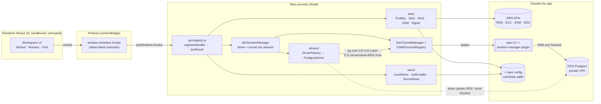
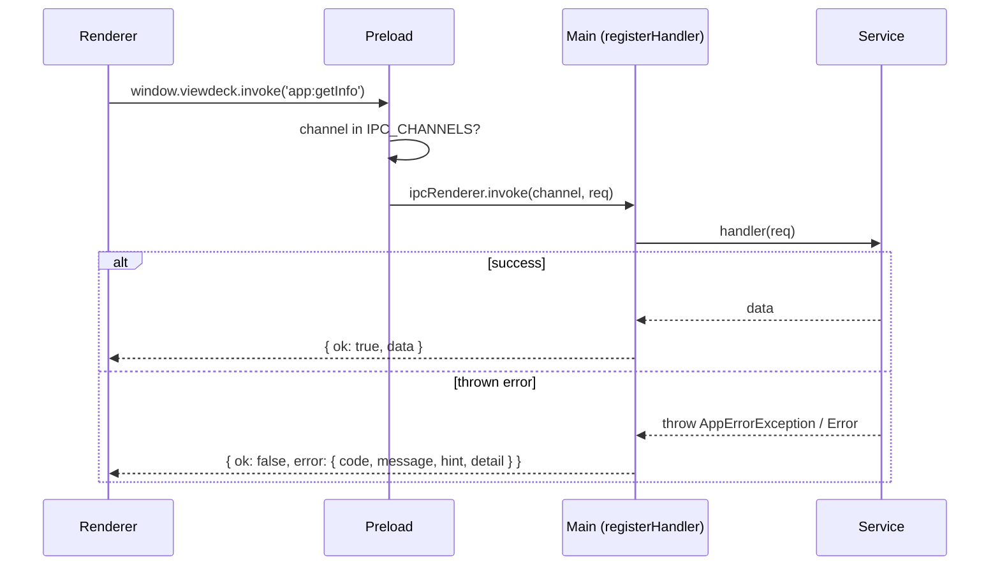
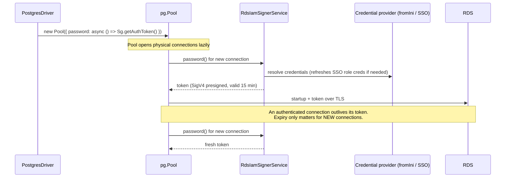
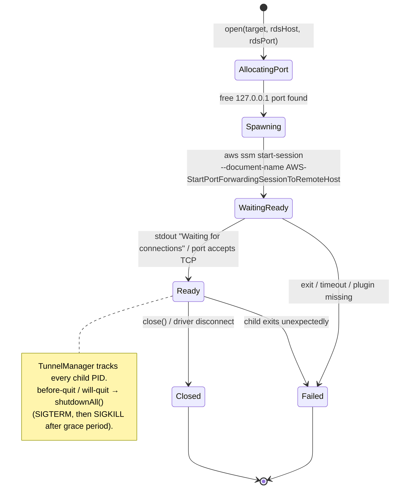
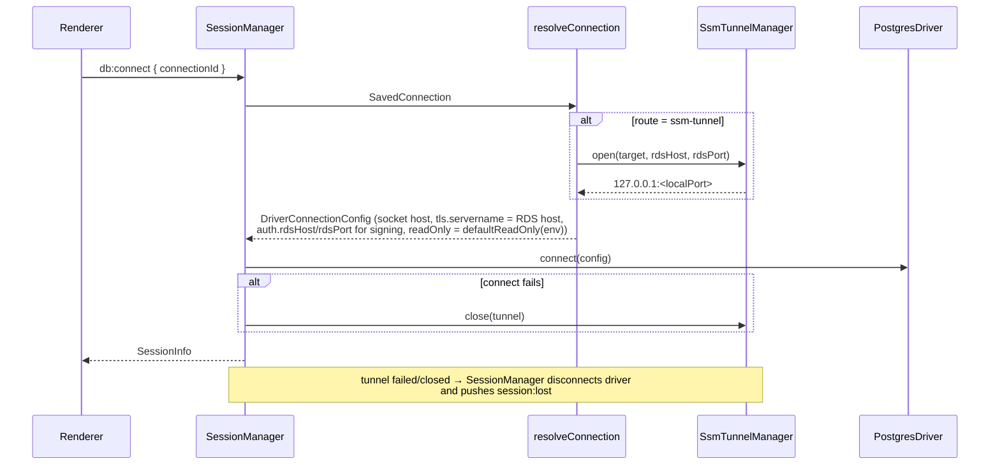
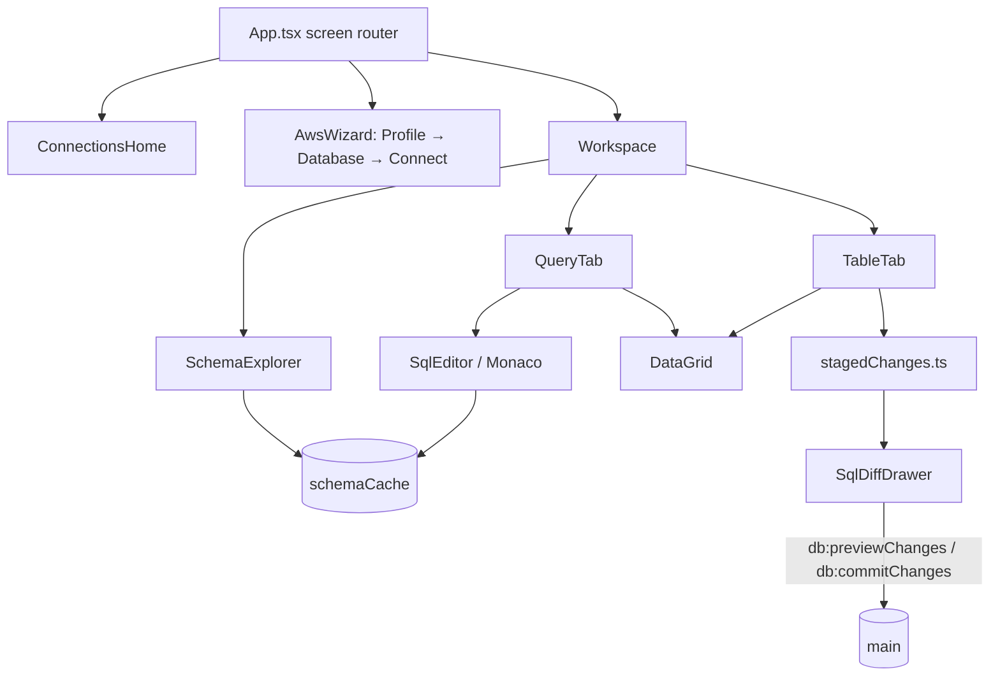

# ViewDeck Architecture

Status: all five milestones are built. `npm run check:docs` keeps this file in sync with the code.
Keep this file in sync with the code (see AGENTS.md § Keeping docs in sync).

## 1. System overview

## 2. Process model and trust boundary

| Layer | Runs in | Can use | Must never |
| --- | --- | --- | --- |
| `src/main` | Node (Electron main) | fs, child_process, AWS SDK, `pg`, `node:sqlite`, `safeStorage` | Trust renderer input without validation |
| `src/preload` | Sandboxed renderer, isolated world | `contextBridge`, `ipcRenderer` | Expose `ipcRenderer` or Node APIs |
| `src/renderer` | Chromium | DOM, React, `window.viewdeck` | Import Node, Electron, `pg`, or the AWS SDK |
| `src/shared` | All of the above | Pure TS only | Import any runtime-specific module |

Window flags: `contextIsolation: true`, `sandbox: true`, `nodeIntegration: false`.
The CSP is set in `src/renderer/index.html`. Monaco needs `worker-src blob:`.

## 3. IPC flow

- **Contract:** `src/shared/ipc.ts` (`IpcContract` + `IPC_CHANNELS`). A compile-time
  assertion fails the build if the two drift apart.
- **Why `IpcResult` instead of throwing:** Electron strips custom error fields across
  `invoke`. A stable `AppErrorCode` lets the UI render targeted remediation (expired SSO,
  missing plugin, IAM denied).
- **Push events** use `webContents.send` through `broadcast()` (`src/main/ipc/events.ts`),
  with names declared in `IpcEvents` / `IPC_EVENTS`. The preload's `on()` strips the
  `IpcRendererEvent` (it exposes `sender`) before calling renderer listeners.
- **Validation:** handlers validate request fields at runtime (`ipc/validate.ts`).
  Strings headed for CLI arguments are rejected if they start with `-`.

### IPC channels

| Channel | Request | Response | Handler |
| --- | --- | --- | --- |
| `app:getInfo` | `void` | `AppInfo` | `appHandlers.ts` |
| `app:writeClipboard` | `{ text }` | `void` | `appHandlers.ts` → Electron `clipboard` (renderer copy actions) |
| `app:closeWindow` | `void` | `void` | `appHandlers.ts` (Cmd+W with no tabs left) |
| `app:saveFile` | `{ defaultName, content }` | `{ path \| null }` | `appHandlers.ts` → native Save dialog (`VIEWDECK_E2E_SAVE_DIR` bypasses it in e2e) |
| `db:getSchemaGraph` | `{ sessionId, schema }` | `SchemaGraph` | `dbHandlers.ts` → `PostgresDriver.getSchemaGraph` → `schemaGraph.ts` (tables, columns, PK/unique keys, FKs in and out of the schema) |
| `update:getStatus` | – | `UpdateStatus` | `updateHandlers.ts` → `UpdateService.current` |
| `update:check` | – | `UpdateStatus` | `UpdateService.check()`: GitHub Releases latest vs `app.getVersion()` |
| `update:download` | – | `UpdateStatus` | `UpdateService.download()` → `UpdateInstaller.prepare()` (download, SHA-256, `ditto`, `codesign`, bundle id/version) |
| `update:restart` | – | – | `UpdateService.requestRestart()` then `app.quit()`; `will-quit` starts the swap + relaunch |
| `aws:listProfiles` | `void` | `AwsProfile[]` | `awsHandlers.ts` → AwsProfileService |
| `aws:getSsoStatus` | `{ profile }` | `SsoStatus` | `awsHandlers.ts` → AwsProfileService |
| `aws:ssoLogin` | `{ profile }` | `SsoStatus` (after CLI exits) | `awsHandlers.ts` → AwsProfileService |
| `aws:cancelSsoLogin` | `{ profile }` | `void` | `awsHandlers.ts` → AwsProfileService |
| `aws:getCallerIdentity` | `{ profile, region }` | `CallerIdentity` | `awsHandlers.ts` → STS |
| `aws:listRdsDatabases` | `{ profile, region }` | `RdsDatabase[]` | `awsHandlers.ts` → RdsDiscoveryService |
| `aws:listTunnelTargets` | `{ profile, region, vpcId }` | `TunnelTarget[]` | `awsHandlers.ts` → TunnelTargetService |
| `aws:checkCliTools` | `void` | `{ awsCli, sessionManagerPlugin }` | `awsHandlers.ts` → cliPath |
| `tunnel:open` | `OpenTunnelRequest` | `TunnelInfo` (ready) | `tunnelHandlers.ts` → SsmTunnelManager |
| `tunnel:close` | `{ id }` | `void` | `tunnelHandlers.ts` → SsmTunnelManager |
| `tunnel:list` | `void` | `TunnelInfo[]` | `tunnelHandlers.ts` → SsmTunnelManager |
| `connections:list` | `void` | `SavedConnection[]` | `storeHandlers.ts` → ConnectionRepository |
| `connections:save` | `SaveConnectionRequest` | `SavedConnection` | `storeHandlers.ts` (encrypts password → SecretStore) |
| `connections:delete` | `{ id }` | `void` | `storeHandlers.ts` (also deletes its secret) |
| `connections:duplicate` | `{ id }` | `SavedConnection` | `storeHandlers.ts` (password re-encrypted under a new secret) |
| `db:connect` | `{ connectionId }` | `SessionInfo` | `dbHandlers.ts` → SessionManager |
| `db:testConnection` | `SaveConnectionRequest` | `{ serverVersion }` | `dbHandlers.ts` (password held in memory only) |
| `db:disconnect` | `{ sessionId }` | `void` | `dbHandlers.ts` → SessionManager |
| `db:listSessions` | `void` | `SessionInfo[]` | `dbHandlers.ts` |
| `db:setReadOnly` | `{ sessionId, readOnly }` | `SessionInfo` | `dbHandlers.ts` → driver.setReadOnly |
| `db:executeQuery` | `{ sessionId, sql, params? }` | `QueryResult` | `dbHandlers.ts` → driver (+ history) |
| `db:explain` | `{ sessionId, sql, analyze }` | `ExplainResult` | `dbHandlers.ts` → driver.explain (`explain.ts`: named statement, ANALYZE inside BEGIN … ROLLBACK) |
| `db:ping` | `{ sessionId }` | `{ ms }` | `dbHandlers.ts` → driver.ping (SELECT 1 on a pool connection) |
| `db:cancelQuery` | `{ sessionId }` | `{ cancelled }` | `dbHandlers.ts` → driver.cancelQuery (pg_cancel_backend on the console pid, via another connection) |
| `db:setStatementTimeout` | `{ sessionId, ms }` | `SessionInfo` | `dbHandlers.ts` → SessionManager → driver (applied at next checkout) |
| `db:listSchemas` | `{ sessionId }` | `SchemaInfo[]` | `dbHandlers.ts` → driver |
| `db:listTables` | `{ sessionId, schema }` | `TableInfo[]` | `dbHandlers.ts` → driver |
| `db:getTableColumns` | `{ sessionId, schema, table }` | `ColumnInfo[]` | `dbHandlers.ts` → driver |
| `db:getPrimaryKeys` | `{ sessionId, schema, table }` | `string[]` | `dbHandlers.ts` → driver |
| `db:listSchemaObjects` | `{ sessionId, schema }` | `SchemaObjects` | `dbHandlers.ts` → driver (`schemaObjects.ts`) |
| `db:getObjectDefinition` | `{ sessionId, kind, id }` | `string` | `dbHandlers.ts` → pg_get_functiondef / reconstructed sequence, enum, domain, composite DDL |
| `db:getForeignKeys` | `{ sessionId, schema, table }` | `{ outgoing, incoming }` | `dbHandlers.ts` → driver.getForeignKeys (`catalog.foreignKeys`, composite-aware) |
| `db:countRows` | `{ sessionId, schema, table, exact, where? }` | `{ count, exact }` | `dbHandlers.ts` → driver.countRows (pg_class estimate, or COUNT(*) with the contained filter + bound param) |
| `db:selectRows` | `{ sessionId, schema, table, limit, offset, where?, orderBy? }` | `QueryResult` | `dbHandlers.ts` → driver.selectRows (`browseSql.ts`: PK order by default, filter bar contained) |
| `db:getSchemaSnapshot` | `{ sessionId }` | `SchemaSnapshot` | `dbHandlers.ts` → driver.getSchemaSnapshot (`schemaSnapshot.ts`) |
| `db:getTableDetails` | `{ sessionId, schema, table }` | `TableDetails` | `dbHandlers.ts` → driver.getTableDetails (`tableDetails.ts` + `tableDdl.ts`) |
| `db:previewChanges` | `{ sessionId, changeset }` | `PreparedStatement[]` | `dbHandlers.ts` → driver |
| `db:commitChanges` | `{ sessionId, changeset }` | `CommitResult` | `dbHandlers.ts` → driver |
| `history:list` | `{ connectionId, limit? }` | `QueryHistoryEntry[]` | `storeHandlers.ts` |
| `queries:list` | `{ connectionId }` | `SavedQuery[]` | `storeHandlers.ts` → SavedQueryRepository (connection + global) |
| `queries:save` | `{ id?, connectionId, name, sql }` | `SavedQuery` | `storeHandlers.ts` |
| `queries:delete` | `{ id }` | `void` | `storeHandlers.ts` |
| `settings:get` / `settings:set` | `void` / `{ settings }` | `AppSettings` | `storeHandlers.ts` → prefs `settings`, normalised (`shared/settings.ts`) |
| `prefs:get` / `prefs:set` | `{ key }` / `{ key, value }` | `unknown` / `void` | `storeHandlers.ts` |

Handlers live in `src/main/ipc/handlers/`.

### Push events (main → renderer)

| Event | Payload | Sent by |
| --- | --- | --- |
| `tunnel:status` | `TunnelInfo` | SsmTunnelManager on every state transition |
| `menu:command` | `{ command: MenuCommand }` | `menu.ts` when a native menu item is clicked; App.tsx dispatches it |
| `update:status` | `UpdateStatus` | `UpdateService` on every lifecycle change (checking, available, download %, ready, error); `UpdateBanner` renders it |
| `session:lost` | `{ sessionId, reason }` | SessionManager when a session's tunnel fails or closes |

## 4. AWS IAM token lifecycle

- The token is a SigV4 presigned URL, valid for **15 minutes**, checked only at
  connection time. A static token string would break every connection the pool opens
  more than 15 minutes after connect. That is why the pool takes a password
  **function**.
- If the SSO session behind the profile expires, credential resolution throws, and it is
  mapped to `AWS_SSO_EXPIRED`. The UI then offers "Sign in with AWS SSO".
- Credentials are memoised per profile (`aws/credentials.ts`) until 5 minutes before
  they expire. Signing a token is then pure local CPU work. `aws:ssoLogin` invalidates
  the profile's cache.
- The signer always signs for the **real** RDS host and port. `createPasswordProvider`
  throws if handed `127.0.0.1` / `localhost`.

### SSO status without network

`AwsProfileService.getSsoStatus` reads `~/.aws/sso/cache/<sha1(session name | start
url)>.json`. An expired access token with a live refresh token (modern `sso-session`
configs) counts as `valid`, because the SDK refreshes it silently.

## 5. SSM port-forwarding tunnel lifecycle

- A free port comes from binding `127.0.0.1:0`, reading the assigned port, and releasing
  it. That leaves a small race, so a spawn that fails with "address already in use"
  retries on a new port (up to 3 attempts).
- Readiness is the plugin's `Waiting for connections` stdout line. The timeout is 30s.
- Failure classification (`classifyExit`): plugin missing → `SSM_PLUGIN_MISSING`,
  `TargetNotConnected` → `SSM_TUNNEL_FAILED` with a hint to pick another host, SSO or
  IAM errors → `AWS_SSO_EXPIRED` / `AWS_ACCESS_DENIED`.
- **Process groups:** `aws` spawns `session-manager-plugin` as a grandchild.
  `ChildProcessRegistry` spawns with `detached: true` and signals `-pid` (the whole
  group), so the plugin never outlives the app. Windows uses `taskkill /T /F`.
- **Quit hooks** (`src/main/index.ts`): `before-quit` → `tunnels.closeAll()` (graceful);
  `will-quit`, `process.on('exit')` and SIGINT/SIGTERM/SIGHUP →
  `processes.killAllSync()`.
- **PATH:** Finder-launched apps get a minimal PATH, so `aws/cliPath.ts` appends the
  Homebrew and installer directories and passes that PATH to children.
- Always connect to `127.0.0.1`, never `localhost`. The plugin binds IPv4, and
  `localhost` may resolve to `::1`.
- Postgres then connects to `127.0.0.1:<localPort>` with
  `ssl: { servername: <rds endpoint>, ca: <RDS global bundle> }`. That keeps
  `verify-full` hostname verification working over the tunnel.

## 6. Sessions, drivers and read-only

- **Pool vs console client.** Each session has one `pg.Pool` (max 4) for introspection
  and commits, plus one pinned *console* client for the SQL editor. `SET`, temp tables
  and `BEGIN` persist across editor runs, as in psql. A dead console client is dropped
  and replaced on the next run.
- **Read-only.** Sessions start with startup option `-c default_transaction_read_only=on`
  when locked. Every checkout re-asserts the setting while locked (a user `ROLLBACK`
  can undo an earlier `SET`), and syncs it when unlocked. SQL matching
  `READ_WRITE_ESCAPE` (SET/RESET of the GUC, `set_config`, `READ WRITE`, session
  characteristics) is rejected client-side while locked. `commitChanges` refuses
  outright when locked.
- **Cancel & timeout.** The console client's backend pid is recorded when it is created.
  `cancelQuery` runs `pg_cancel_backend(pid)` from a pool connection while the console is
  busy. `statement_timeout` defaults by tier (`defaultStatementTimeoutMs`: prod/unknown
  30s, staging 60s, dev off). It is set at startup and re-synced at checkout by
  `StatementTimeoutTracker`. SQLSTATE 57014 maps to "Query cancelled." or "exceeded the
  statement timeout".
- **Values.** Type parsers keep Postgres text for everything except bool, int2/4, oid
  and finite floats. int8/numeric are exact strings, timestamps follow the session
  TimeZone verbatim, bytea is `\x…`, json is text. Column type names come from a
  `pg_type` oid map loaded at connect.
- **Commits.** `previewChanges` and `commitChanges` share `buildChangesetStatements`.
  Commit runs `BEGIN … COMMIT` on one pool client. Any error, or a keyed
  UPDATE/DELETE affecting ≠ 1 row, rolls back everything.
- **Errors.** `pgErrors.ts` maps SQLSTATE 28P01/28000 → `DB_AUTH_FAILED` (with an
  `rds_iam` grant hint for IAM), 25006 → `DB_READ_ONLY`, socket/TLS codes →
  `DB_CONNECTION_FAILED`.

## 7. Renderer

- **State:** `lib/store.ts` holds navigation, session and tab state. Server data is
  fetched per component with `useAsync`, or for schema metadata through `schemaCache`
  (deduplicated, invalidated on DDL, refresh and session change).
- **Wizard memory:** `prefs` keys `wizard.region:<profile>` (saved as soon as a valid
  region is entered), `wizard.db:<profile>:<rdsIdentifier>` (user, database, auth, route,
  tunnel host; saved on a successful Test or Save) and `wizard.route:<profile>` (Direct
  vs SSM habit for unseen private DBs). `applyWizardMemory` merges them into the draft.
- **Wizard:** step 1 lists profiles (`aws:listProfiles`), checks the SSO cache, offers
  "Sign in with AWS SSO" (`aws:ssoLogin`) and verifies with STS. Step 2 is searchable
  RDS discovery. Step 3 sets auth and environment. For private databases it also sets
  the network path: Direct (VPN or peered network) or SSM tunnel, where the tunnel host
  comes from `aws:listTunnelTargets` (see ADR-004). Then it tests or saves and connects. Draft → request mapping
  is in `connectionDraft.ts`.
- **Fast autocomplete:** on connect, `schemaCache` loads the last snapshot for this saved
  connection from `prefs` (instant), then fetches a fresh one with `db:getSchemaSnapshot`
  (one round trip for every schema, table and column, capped at 250k columns) and
  persists it. `SchemaIndex` answers lookups synchronously, with search_path-aware
  resolution. `suggestions.ts` builds suggestions purely. DDL and Refresh keep serving
  the stale index until the new snapshot lands.
- **Query results:** Run (or Cmd+Enter over a selection) with several statements calls
  `QueryTab.runScript`: it splits them with `splitStatements` and sends each as its own
  `db:executeQuery`, like psql, so one failure keeps the other results. They all run on
  the pinned console client, so a script's own `BEGIN … COMMIT` still spans statements,
  and the read-only guard checks each one. The danger guard runs once over the whole
  script first. `QueryResults` shows an **All** tab (`ScriptOutputView`: SQL plus
  psql-style output for each statement, with timestamp hover showing local, UTC and
  relative time) and one tab per statement. **Copy all** (`scriptOutput.ts`, pure)
  copies every query with its result as Markdown, plain text or JSON. Above a result grid,
  `ResultToolbar` holds a **WHERE filter** that `resultFilter.ts` (pure) parses and evaluates
  on the rows already loaded. It updates live as you type and never touches the database.
  Incomplete or invalid input shows every row, marked "not applied", never an error. The
  filter text survives re-runs. **Find** (⌘F, unless focus is in the SQL editor) highlights
  matching cells and cycles through them with Enter (`useResultFilter`,
  `DataGrid.highlight` / `focusCell`). Export copies TSV, CSV, JSON or
  Markdown, or saves CSV or JSON via `app:saveFile`. A SQL error's Postgres `position`
  (`AppError.context.position`) is mapped to the run's offset in the document and
  underlined (`SqlEditor.markError`). The marker clears on the next edit or run.
- **Split view & compare rows:** `AppState.split` holds `{ left, right }` tab ids.
  `setState` runs `splitView.normalizeSplit` after every change, so all tab-switch paths
  (strip, Ctrl+Tab, palette, open table) work: activating a tab outside the split replaces
  the focused pane, and closing either tab ends it. `CompareRowsDialog` shows
  `compareRows.ts` output (columns aligned by name, differences flagged) for two selected
  rows or a row against `AppState.pinnedRow`.
- **EXPLAIN visualiser:** `Cmd+E` / `Cmd+Shift+E` (`SqlEditor` actions) send the
  selection or statement at the cursor to `db:explain`. `drivers/postgres/explain.ts`
  runs `EXPLAIN (FORMAT JSON[, ANALYZE, BUFFERS])` as a named statement (the extended
  protocol rejects a second statement). ANALYZE executes the statement, so it always runs
  in `BEGIN … ROLLBACK`; a read-only session's transaction is read-only, so writes fail on
  the server. Destructive SQL still goes through the danger guard first. `planTree.ts`
  (pure) flattens the plan with self time and misestimate factors; `PlanView` renders it.
- **Dangerous-statement guard:** in unlocked sessions, `requestRun` checks
  `dangerGuard.findDangers`, which blanks out literals and comments first, then flags
  UPDATE/DELETE without WHERE, TRUNCATE, DROP and ALTER … DROP. `DangerConfirmDialog` lists
  each statement, and on prod the user must type the database name. Read-only sessions
  need no guard, because the server rejects writes.
- **Recent & starred:** the query-tab toolbar has Run, Star (`StarQueryDialog` → `queries:save`)
  and a toggle for `QueriesPanel` (Recent = `history:list`, deduped; Starred =
  `queries:list`). Both are searchable, with click to open, new tab, copy, rename and
  delete. Starred queries also appear in Cmd+K.
- **Editor:** Cmd/Ctrl+Enter runs the selection, or the statement under the cursor
  (`statementAtCursor.ts` handles quotes, dollar-quoting and comments). Completion
  comes from `completionContext.ts` (aliases, `schema.`) plus `schemaCache`.
- **Grid:** TanStack Table defines and resizes columns. TanStack Virtual renders only
  visible rows (24px rows, overscan 20). Staged edits are amber, inserts green and
  deletes struck through. Cmd/Ctrl+S opens `SqlDiffDrawer`, which shows exactly what
  `db:previewChanges` returns. Read-only sessions and PK-less tables restrict editing.
- **Filter bar:** `FilterBar.tsx` (Cmd/Ctrl+F) sends a raw `WHERE` condition and an optional
  `ORDER BY` with `db:selectRows`. `browseSql.ts` parenthesises them on their own lines,
  before `LIMIT $1 OFFSET $2`, so comments and `OR` stay contained, and bound parameters
  block a second statement. Filtering is refused while edits are staged, because staged
  edits address rows by their position in the loaded page.
- **Sidebar:** tables show the snapshot's row estimate. Each schema has lazily loaded
  Functions / Sequences / Types groups (`SchemaObjectsGroup`), and clicking one opens its
  definition in a new query tab. The table menu's "Generate TRUNCATE / DROP" writes the
  statement into a tab without running it. Running it goes through the destructive-SQL
  guard.
- **Foreign-key navigation:** outgoing-FK cells show a hover ↗ that opens the referenced
  table filtered to that row (`actions.openTable(..., { where })`, which re-filters an open
  tab). The cell's right-click menu also lists "Rows in <child>" for incoming FKs. Targets
  come from `fkLinks.ts`. NULL key parts mean no link.
- **Readable values:** hovering a timestamp or date cell shows local, UTC and relative
  time. Integer epoch columns get a header-menu "Format as date (epoch ms / s)", remembered
  per table in `prefs` (`colfmt:<connection>:<schema>.<table>`). Copy actions always use
  the raw value.
- **Type-aware editing:** `CellEditor` uses a dropdown for enums (labels from `pg_enum` via
  `ColumnInfo.enumValues`), true/false for bool, a date picker for date, and "now" for
  timestamps. JSON goes through the value viewer.
- **Sorting & totals:** clicking a header cycles asc → desc → off by writing `"col" ASC|DESC`
  into the filter bar's ORDER BY (`sortOrder.ts`). The pager shows `of ~N` (planner
  estimate) and a Count button for an exact `COUNT(*)` honouring the filter.
- **Table info (ⓘ):** `TableInfoDrawer.tsx` → `db:getTableDetails`. It shows stats
  (estimated, live and dead rows, total, table, index and TOAST sizes, scan counts,
  writes, and last vacuum and analyze), indexes with size, scans and an "unused" flag,
  constraints, referencing foreign keys, triggers, and DDL reconstructed by `tableDdl.ts`
  from pg_get_*def catalog functions (Postgres has no `pg_get_tabledef`).
- **Grid interaction:** `useGridSelection` (cell cursor, Cmd/Shift row selection, keyboard
  nav). `GridContextMenu` handles copy cell, rows as JSON / TSV / CSV / Markdown / INSERT,
  copy as WHERE, view value, filter by value, sort, and edit / set NULL / delete when
  editable. `ValueViewer` + `JsonTree` give a collapsible JSON tree with copy value /
  JSONPath / Postgres accessor per node. Edits from the viewer are staged. The formatters
  are pure: `copyFormats.ts`, `jsonPath.ts`.
- **Context menus everywhere:** grid cells and headers, sidebar tables (Open, `SELECT …
  LIMIT 100`, count, info, copy name), tabs (close / close others / close all / duplicate),
  saved connections, and the native Cut/Copy/Paste menu on text fields (main `context-menu`
  handler). Sidebar tables are draggable into Monaco (`text/plain` = qualified name).
- **ER diagram:** `DiagramTab` (tab kind `diagram`, opened from the sidebar schema row, a
  table's "Show in diagram" or ⌘K "Diagram: <schema>"). `db:getSchemaGraph` returns one
  schema plus external FK endpoints in four catalog queries. `graphModel.ts` (pure, tested)
  turns that into typed edges: cardinality from PK/unique keys, required from nullability.
  `inferRelations.ts` adds `*_id` → table guesses, drawn dashed. Clusters come from connected
  components split by a deterministic Louvain pass, with small clusters merged back
  (`clusterMerge.ts`). It also finds hubs and isolated tables. `diagramLayout.ts` runs ELK in
  a Web Worker (`layout.worker.ts`): `layered` inside each cluster, `rectpacking` for the
  clusters. React Flow renders cards with semantic zoom: names only below 45%, and cluster
  labels at constant screen size for the map view. Edges are crow's-foot SVG markers. Only
  visible elements render. `diagramCache.ts` keeps the graph, layout and dragged positions
  per connection in prefs, keyed by a structure fingerprint, so reopening is instant and the
  schema refreshes in the background.
- **Updates:** `UpdateService` (`src/main/update/`) checks GitHub Releases at launch and every
  12 hours (Settings → "Check for updates", off in e2e), and on demand from the menu or ⌘K.
  `UpdateBanner` (bottom-right card) offers **Update now**. `UpdateInstaller` then downloads
  the arch's `ViewDeck-<v>-<arch>-mac.zip` while hashing it, checks it against the release's
  `SHA256SUMS.txt`, extracts it with `ditto`, and verifies it with `codesign --verify --deep
  --strict` and the Info.plist bundle id and version. It stages the result under
  `<userData>/updates`. It also checks that the archive holds exactly one real `ViewDeck.app`,
  that the URLs are this repo's release downloads, that the version is plain `x.y.z`, and it
  aborts a download after 60 s with no data. **Restart now** (or any normal quit) runs
  `SWAP_SCRIPT` at `will-quit` through `ChildProcessRegistry.spawnDetachedAfterExit`, the one
  process allowed to outlive the app. The script waits for our PID, and skips the swap if the
  app is still running. It copies the new bundle next to the old one, does two same-folder
  renames (restoring the old bundle on failure) and relaunches.
  Squirrel/electron-updater isn't used because it requires a Developer ID signature. When
  the app can't replace itself (dev build, running from the DMG or a translocated or
  read-only location), the card links to the release page instead.
- **Settings:** `SettingsDialog` (⌘, or menu) edits `AppSettings`: theme (dark, light or
  system, via `useApplyTheme` + light/dark Monaco themes), editor font size, page size,
  date display (local or UTC for formatted epochs), and per-tier "starts read-only" and
  default statement timeout. Main reads them in `SessionManager.getSettings` →
  `resolveConnection`, so they apply to new sessions.
- **Theme:** Light / Dark / System. `ThemeMenu` (header, both screens), ⌘K "Theme: …" and
  Settings all save through `setTheme` (`lib/theme.ts`), which updates the store first so
  the change is instant. `useApplyTheme` sets `html.dark` and `color-scheme`. "System"
  follows `prefers-color-scheme` live via `useSystemDark`, Monaco included. In main,
  `settings:set` and startup call `applyNativeTheme` (`nativeTheme.ts`), which sets
  `nativeTheme.themeSource` so native menus and dialogs match, and repaints the window
  background.
- **Status & resilience:** `StatusBar` shows user@host/db, environment, SSM tunnel state
  (`tunnel:status`), latency (`db:ping` every 15 s), session age, read-only state, timeout and
  server version. On `session:lost` (tunnel died), `recoverSession` reconnects with backoff
  (1/3/10/30 s) behind a banner and swaps in the new session with the same tabs, ending the
  session only if every attempt fails. Direct connections self-heal: dead idle clients are
  discarded and new ones sign fresh IAM tokens.
- **Workspace persistence:** `workspacePersistence.ts` saves each saved connection's tabs
  (query text, table filters, active tab) to `prefs` `workspace:<connectionId>`, debounced
  at 600 ms with a 3 s maximum. Silent changes (editor keystrokes, filters) notify through
  `subscribeAll`. `flushWorkspaceSave` runs before leave or switch and on unload.
  `enterSession` restores, and table tabs reapply their filter via `filterRequest`.
- **Connections:** `ConnectionSwitcher` (header) lists saved connections grouped by
  environment, plus New AWS / Manual / Manage. Switching connects the new session first
  (`lib/sessions.ts`), then closes the old one, and asks before discarding staged edits
  (`dirtyTabs` in the store). Home offers Edit (`EditConnectionDialog`, every field; a
  blank password keeps the secret), Duplicate, and confirmed Delete.
- **Read-only toggle:** locking is instant. Unlocking a non-dev session needs a
  confirmation dialog.
- **Command palette:** `features/palette/CommandPalette.tsx` (Cmd/Ctrl+K, also bound
  inside Monaco) ranks items from `paletteItems.ts` with `fuzzy.ts`: actions, tables
  across all schemas (capped at 100 schemas), schema filters, recent queries
  (`history:list`) and saved connections. The palette can lock a session but never
  unlock it.
- **Errors:** `ErrorBanner` renders `AppError.steps`, `command` (copy), `docsUrl`, and an
  inline SSO sign-in plus retry for `AWS_SSO_EXPIRED`. `ErrorBoundary` wraps the app, so
  a render crash shows a recoverable error instead of a blank window.

### Error codes → remediation

| Code | Produced by | What the user sees |
| --- | --- | --- |
| `AWS_SSO_EXPIRED` | `awsErrors.ts` (also via the pg IAM token callback, mid-session) | Inline "Sign in with AWS SSO" → retry; `aws sso login` command |
| `AWS_ACCESS_DENIED` | `awsErrors.ts` | Checklist of required IAM actions |
| `AWS_CREDENTIALS_MISSING` | `awsErrors.ts`, wizard | `aws configure sso` command + docs |
| `AWS_NETWORK_ERROR` | `awsErrors.ts` | Internet/VPN/proxy/region checklist |
| `AWS_CLI_MISSING` / `SSM_PLUGIN_MISSING` | `remediation.ts` | Platform install command (`brew …`) + docs |
| `SSM_TUNNEL_FAILED` | `SsmTunnelManager` | Target-not-connected / timeout checklists |
| `DB_AUTH_FAILED` (IAM) | `pgErrors.ts` | 5-step IAM checklist, `GRANT rds_iam …` command, AWS troubleshooting docs |
| `DB_CONNECTION_FAILED` | `pgErrors.ts` | Tunnel / security group / TLS checklists |
| `DB_READ_ONLY` | `pgErrors.ts`, `readOnly.ts` | Points at the lock toggle |

## 8. Local persistence

`<userData>/viewdeck.sqlite` (`node:sqlite`, WAL). Migrations are an append-only
array in `store/migrations.ts`, tracked by `PRAGMA user_version`.

| Table | Holds |
| --- | --- |
| `connections` | SavedConnection JSON (route, auth kind and user, `secretRef`, AWS context). No secrets. |
| `secrets` | `safeStorage.encryptString` ciphertext only. Refuses to write if OS encryption is unavailable or Linux `basic_text`. |
| `query_history` | Executed SQL with duration, rows or error. Pruned to 1000 per connection. |
| `preferences` | JSON key/value (also the per-connection schema snapshot cache). |
| `saved_queries` | Starred queries; `connection_id` NULL = shown on every connection (migration v2). |

`db:testConnection` with an unsaved password uses `TransientSecrets` (in memory, deleted
after the test). The password never touches disk.

The RDS CA bundle (`resources/rds-global-bundle.pem`, from
`truststore.pki.rds.amazonaws.com/global/global-bundle.pem`) is loaded through
`resources.ts`. In dev it is read from the repo; packaged builds read it from
`process.resourcesPath`, so the packager must ship `resources/` as extraResources.

## 8b. Native menu

`src/main/menu.ts` installs ViewDeck / File / Edit / Query / View / Window menus and sets
the app name, About panel and dev dock icon. Items mirroring in-app shortcuts (Cmd+Enter,
Cmd+S, Cmd+F, Cmd+K, Cmd+T, Ctrl+Tab) use `registerAccelerator: false`. The shortcut is
shown but not grabbed, so Monaco and the grid keep it. A click broadcasts `menu:command`.
App.tsx handles global commands; tab-scoped ones (`runStatement`, `cancelQuery`,
`reviewChanges`, `focusFilter`) go through `store.tabCommand` to the active tab. Cmd+W is a
real accelerator: it closes the active tab, or the window when no tabs are left.

## 9. Module map

| Module | Path | Status |
| --- | --- | --- |
| IPC contract | `src/shared/ipc.ts` | ✅ |
| Result / error envelope | `src/shared/types/result.ts` | ✅ |
| Driver contract | `src/shared/types/driver.ts` | ✅ |
| Connection / session types | `src/shared/types/connection.ts` | ✅ |
| Environment heuristics | `src/shared/environment.ts` | ✅ |
| Main entry + window | `src/main/index.ts` | ✅ |
| IPC registry | `src/main/ipc/registry.ts`, `toAppError.ts`, `handlers/` | ✅ |
| Preload bridge | `src/preload/index.ts` | ✅ |
| Renderer shell | `src/renderer/src/App.tsx`, `components/EnvironmentBar.tsx` | ✅ |
| Composition root | `src/main/services.ts` | ✅ |
| Push events, IPC validation | `src/main/ipc/events.ts`, `ipc/validate.ts` | ✅ |
| ChildProcessRegistry | `src/main/process/` | ✅ |
| AwsProfileService (+ ssoTokenCache, iniParser) | `src/main/aws/` | ✅ |
| AwsClientFactory, error mapping | `src/main/aws/credentials.ts`, `awsErrors.ts` | ✅ |
| RdsDiscoveryService, TunnelTargetService | `src/main/aws/` | ✅ |
| SsmTunnelManager (+ freePort, cliPath) | `src/main/aws/` | ✅ |
| RdsIamSignerService | `src/main/aws/` | ✅ |
| DriverFactory, PostgresDriver (+ pgConfig, changesetSql, introspection, typeParsers, pgErrors) | `src/main/drivers/` | ✅ |
| SessionManager, resolveConnection | `src/main/db/` | ✅ |
| LocalStore, SecretStore, repositories | `src/main/store/` | ✅ |
| DB IPC validation | `src/main/ipc/validateDb.ts` | ✅ |
| Resource paths / RDS CA | `src/main/resources.ts`, `resources/` | ✅ |
| Renderer lib (ipc, store, useAsync, hotkeys) | `src/renderer/src/lib/` | ✅ |
| Connection home, manual dialog, AWS wizard | `src/renderer/src/features/connect/` | ✅ |
| Workspace, SchemaExplorer, ReadOnlyToggle | `src/renderer/src/features/workspace/` | ✅ |
| Monaco editor, completion, statement splitter | `src/renderer/src/features/editor/` | ✅ |
| DataGrid, TableTab, staged edits, SQL diff drawer, FilterBar, TableInfoDrawer | `src/renderer/src/features/grid/` | ✅ |
| Table browse SQL, table details + DDL | `src/main/drivers/postgres/browseSql.ts`, `tableDetails.ts`, `tableDdl.ts` | ✅ |
| EXPLAIN (driver + plan tree UI) | `src/main/drivers/postgres/explain.ts`, `src/renderer/src/features/editor/planTree.ts`, `PlanView.tsx` | ✅ |
| Command palette (+ fuzzy matcher) | `src/renderer/src/features/palette/` | ✅ |
| ErrorBanner, ErrorBoundary | `src/renderer/src/components/` | ✅ |
| Missing-tool remediation | `src/main/aws/remediation.ts` | ✅ |
| Test helpers | `src/main/testing/fakeChild.ts` | ✅ |
| E2E smoke test | `e2e/smoke.e2e.mjs` | ✅ |
| Docs drift check | `scripts/check-docs.mjs` | ✅ |

## 10. Build

`electron-vite` 6 builds three bundles into `out/`: `main` (CJS, deps externalised),
`preload` (CJS, which a sandboxed preload requires; `@shared` is inlined), and
`renderer` (Vite + React + Tailwind v4 via `@tailwindcss/vite`). Electron 45 has no
binary postinstall of its own, so `npm install` runs `install-electron` to fetch it.
