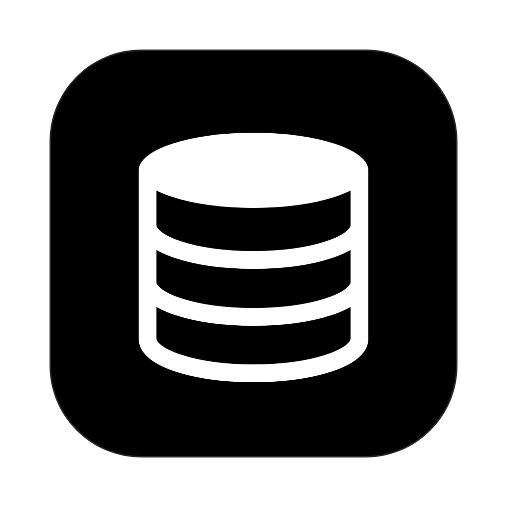
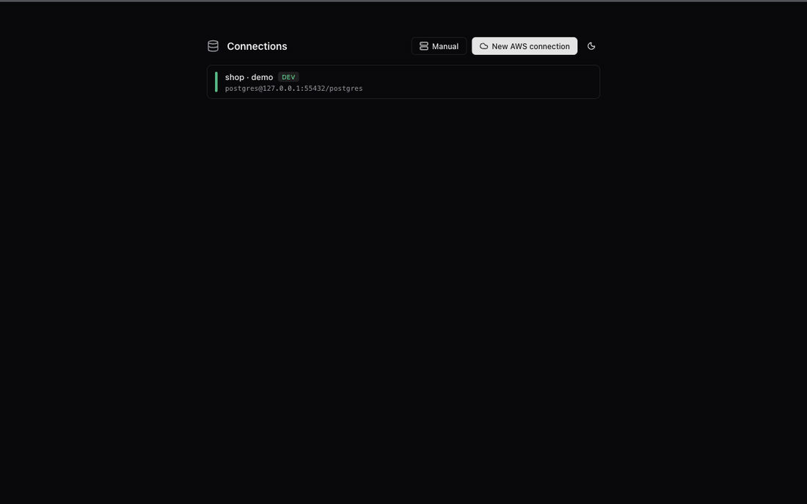

<div align="center">



# ViewDeck

### The free, keyboard-first database GUI for PostgreSQL, Amazon RDS & Aurora

Query, explore and safely edit your data. Connect to private cloud databases in seconds,
with no bastion host, no SSH keys and no stored passwords. **Free forever.**

<a href="https://github.com/sponsors/Adityagaddhyan"></a>
&nbsp;
<a href="https://buymeacoffee.com/adityagaddhyan"></a>

[](https://github.com/Adityagaddhyan/viewdeck/actions/workflows/ci.yml)
[](https://github.com/Adityagaddhyan/viewdeck/actions/workflows/codeql.yml)
[](LICENSE)
[](#-free-and-open-source)
[](#-install)
[](#-supported-databases)
[](#-features)
[](https://github.com/Adityagaddhyan/viewdeck/stargazers)

**[Install](#-install)** · **[Quick start](#-quick-start)** · **[Features](#-features)** · **[Why ViewDeck](#-why-viewdeck)** · **[FAQ](#-faq)** · **[Support](#-support-the-project)** · **[Contribute](#-contributing-and-development)**

<br />



<sub>Connect · stage an edit and review the exact SQL · run a batch of queries · filter results live · find in results</sub>

</div>

<br />

## 📦 Install

**Homebrew** (recommended). This also installs the AWS CLI and the Session Manager plugin
that the AWS features use:

```sh
brew install --cask adityagaddhyan/tap/viewdeck
```

**Or download the app** from the [latest release](https://github.com/Adityagaddhyan/viewdeck/releases/latest):
`ViewDeck-<version>-arm64.dmg` for Apple Silicon, `-x64.dmg` for Intel. Open it and drag
ViewDeck to Applications. For AWS databases, also install
`brew install awscli && brew install --cask session-manager-plugin`.

> **First launch:** ViewDeck isn't notarised by Apple yet, so macOS says it can't verify the
> developer. Open **System Settings → Privacy & Security**, scroll down and click
> **Open Anyway** (only once).

**Updates are built in.** ViewDeck tells you when a new version is out. Click **Update now**,
then **Restart**, and you're on the latest version. Homebrew users can also run
`brew upgrade --cask viewdeck`.

<details>
<summary><b>Build from source</b></summary>

Needs [Node.js](https://nodejs.org) 22.13 or newer:

```sh
git clone https://github.com/Adityagaddhyan/viewdeck.git
cd viewdeck
npm install
npm run dist:dir
cp -R release/mac*/ViewDeck.app /Applications/
```
</details>

## 🚀 Quick start

**1. Connect to a database**

- **On AWS:** click **New AWS connection**, pick a profile from `~/.aws` (use **Sign in
  with AWS SSO** if asked), then pick your RDS instance or Aurora cluster from the list.
  Choose how to reach it:
  - **Direct** if you're on a VPN that reaches the VPC, or the database is public.
  - **SSM tunnel** for a private database. Pick an SSM-managed EC2 instance in the same VPC,
    and ViewDeck runs the tunnel for you.

  Then choose **IAM** or **password** auth and click **Connect**.
- **Any other Postgres** (local, Docker, other clouds): click **Manual**, enter host,
  port, database, user and password, then **Test** and **Save & connect**.

Connections are saved (passwords encrypted in your OS keychain), so next time it's one
click. Names containing `prod` or `staging` get a coloured frame and start read-only.

**2. Explore**

- Click a table in the sidebar to browse it, with paging, sorting and a `WHERE` filter
  bar (`⌘F`).
- Press `⌘K` to jump to any table, schema, recent query or connection.
- Double-click a JSON cell for a tree view. Click the ↗ on a foreign-key value to open the
  row it points to.

**3. Query**

- `⌘T` opens a query tab. Write SQL with autocomplete, then:
  - `⌘↵` runs the statement under the cursor.
  - **Run** runs every statement. The **All** tab shows each result, and **Copy all**
    copies them in one go.
- Above any result, type a condition like `status = 'paid' and amount > 100` to filter
  rows live, and press `⌘F` to find text.
- `⌘E` shows the query plan.

**4. Edit safely**

- Unlock the session with the **Read-only** toggle in the header (anything outside dev
  asks you to confirm).
- Double-click a cell to edit it, then press `⌘S` to review the exact SQL and **Commit**.
  Nothing is written before that.

## ☕ Support the project

ViewDeck will always be free. If it saves you time, you can support its development. It
helps keep new engines and features coming.

<a href="https://github.com/sponsors/Adityagaddhyan"></a>
&nbsp;
<a href="https://buymeacoffee.com/adityagaddhyan"></a>

Starring the repo and telling a colleague helps too.

## 💡 Why ViewDeck

If your databases live on AWS, getting to them is usually the hardest part of the job.
ViewDeck takes care of all of it.

| The usual pain | With ViewDeck |
| --- | --- |
| Private RDS means a bastion host, SSH keys, or an `aws ssm` port-forward running in a terminal, plus remembering which local port you used | Pick the database and connect. ViewDeck opens and manages the **SSM tunnel** for you, and closes it when you're done |
| IAM database auth tokens expire every 15 minutes, so you keep pasting fresh `generate-db-auth-token` output | A fresh **IAM token** is signed automatically for every new connection |
| TLS fails through a tunnel (`127.0.0.1` vs `*.rds.amazonaws.com`), so verification gets switched off | Full **`verify-full` TLS** against the real RDS hostname, tunnel or not |
| One `UPDATE` without a `WHERE` on prod, or a cell edit that writes straight away | **Read-only by default** on prod, **staged edits** shown as exact SQL, and a check before destructive queries |
| Copying the results of ten queries one by one | **Run them all at once** and **copy every result** in one click |
| Good database tools are paid, need an account, or phone home | **Free and open source.** No account, no telemetry |

## ✨ Features

<table>
<tr>
<td width="50%" valign="top">

### ⚡ Write and run SQL
- **Monaco editor** (the VS Code editor) with schema-aware autocomplete
- `⌘↵` runs the statement under the cursor; errors are underlined in place
- **Run a whole script**: each query's result in one view, **Copy all** as Markdown, text or JSON (great for the queries an AI agent hands you)
- **EXPLAIN / ANALYZE** plan tree with timings; ANALYZE is always rolled back
- Recent and starred queries, statement timeouts, cancel

</td>
<td width="50%" valign="top">

### 🔎 Explore results
- **Live SQL filter**: type a `WHERE` condition and rows narrow as you type, entirely client-side
- **Find in results** (`⌘F`) with match highlighting
- **Virtualised grid** for 100k+ rows; copy as TSV, CSV, JSON, Markdown, `INSERT` or `WHERE`
- **JSON/JSONB tree viewer**; epoch columns shown as dates; local/UTC on hover
- **Foreign-key navigation**, **split view**, **compare rows**

</td>
</tr>
<tr>
<td width="50%" valign="top">

### 🛡️ Edit data safely
- **Staged edits**: nothing writes until `⌘S` shows the exact parameterised SQL
- One `BEGIN … COMMIT`, all-or-nothing, with expected-row checks
- **Server-enforced read-only** outside dev, plus colour-coded environments (prod red, staging amber, dev green)
- **Destructive SQL asks first**; on prod you type the database name

</td>
<td width="50%" valign="top">

### ☁️ Built for AWS
- **AWS SSO** sign-in inline, profiles read from `~/.aws`
- **RDS & Aurora discovery**: pick from a list, no endpoints to copy
- **Private VPC databases over SSM**, with no bastion and no SSH keys
- **IAM database authentication** that never expires mid-session
- **No plaintext secrets**: passwords are encrypted with the OS keychain

</td>
</tr>
</table>

**Keyboard-first throughout:** `⌘K` command palette · `⌘T` new tab · `⌘↵` run · `⌘E` explain · `⌘F` filter / find · `⌘S` review changes · `Ctrl+Tab` switch tabs. Light, dark or system theme.

## 🎁 Free and open source

ViewDeck is **completely free**: MIT licensed, with no "pro" tier, no license key, no
sign-up and no usage tracking. Network traffic goes to your own databases and to AWS, plus a
small update check against GitHub Releases that sends nothing about you (you can turn it off
in Settings). Use it at work or at home, fork it, or add your own database driver.

## 💾 Supported databases

| Engine | Status |
| --- | --- |
| **PostgreSQL**, including Amazon RDS & Aurora PostgreSQL | ✅ Supported |
| MySQL / MariaDB, including Aurora MySQL | 🛠️ Planned |
| SQLite | 🛠️ Planned |
| ClickHouse | 🛠️ Planned |
| DynamoDB and others | 🛠️ Planned: [adding an engine](docs/ADDING_A_DATABASE.md) is one folder and one line |

ViewDeck is engine-agnostic by design: the UI talks to a small `DatabaseDriver` contract,
so new databases plug in without changes to the app.

## ❓ FAQ

<details>
<summary><b>Is ViewDeck really free?</b></summary>

Yes. It's MIT-licensed open source, with no paid tier, no account and no telemetry.
</details>

<details>
<summary><b>How do I connect to a private RDS or Aurora PostgreSQL database without a bastion host or SSH keys?</b></summary>

Choose the **SSM tunnel** route when you add an AWS connection. ViewDeck starts an AWS
Systems Manager port forward through an SSM-managed EC2 instance in the same VPC, keeps it
alive while you work, and closes it when you disconnect. If you're already on a VPN that
reaches the VPC, the **Direct** route connects straight to the endpoint.
</details>

<details>
<summary><b>Does it support RDS IAM database authentication?</b></summary>

Yes. ViewDeck signs a fresh IAM auth token for every new pooled connection, so the
15-minute expiry never interrupts you, and it verifies TLS against the real RDS hostname,
even through a tunnel.
</details>

<details>
<summary><b>Does it work with AWS SSO (IAM Identity Center)?</b></summary>

Yes. It reads your profiles from `~/.aws` and offers an inline "Sign in with AWS SSO" when
a session has expired.
</details>

<details>
<summary><b>How is it different from TablePlus, DataGrip, DBeaver or pgAdmin?</b></summary>

Those are great general-purpose tools. ViewDeck is free and focused: AWS connectivity
(SSO, RDS discovery, IAM tokens, SSM tunnels) is built in rather than bolted on, writes are
safe by default (staged edits, read-only prod, destructive-query checks), and the whole app
is designed for the keyboard.
</details>

<details>
<summary><b>Which databases and platforms are supported?</b></summary>

PostgreSQL today, including Amazon RDS and Aurora PostgreSQL. MySQL/MariaDB, SQLite and
ClickHouse are planned. ViewDeck is built and tested on macOS; it's an Electron app, so
Windows and Linux builds are possible, and contributions are welcome.
</details>

<details>
<summary><b>Is it safe to point at production?</b></summary>

That's what it's designed for. Sessions outside dev start **read-only**, and Postgres
itself enforces it, not just the UI. Grid edits are staged and committed in one
transaction after you review the exact SQL. Destructive statements ask for confirmation
(on prod you type the database name). The UI runs in a sandboxed renderer, and every
privileged action goes through one typed, validated IPC boundary.
</details>

## 🤝 Contributing and development

```sh
npm install
npm run dev            # app with hot reload
npm run verify         # typecheck + unit tests + docs check
npm run test:e2e       # drive the real app against a local TLS Postgres
```

Start with [`AGENTS.md`](AGENTS.md) (repo map, invariants, conventions, for humans and AI
agents alike), then [`ARCHITECTURE.md`](ARCHITECTURE.md). Guides:
[adding a database](docs/ADDING_A_DATABASE.md) · [packaging](docs/PACKAGING.md) ·
[roadmap](docs/ROADMAP.md) · [decision records](docs/adr/). Contributions are welcome,
especially new database drivers: see [CONTRIBUTING.md](CONTRIBUTING.md).
Security issues: [SECURITY.md](SECURITY.md).

<br />

<div align="center">

**If ViewDeck saves you time, a ⭐ helps other developers find it.** You can also [sponsor](https://github.com/sponsors/Adityagaddhyan) or [buy me a coffee](https://buymeacoffee.com/adityagaddhyan) ☕

<sub>MIT licensed · Built with Electron, React, TypeScript and Monaco</sub>

</div>
