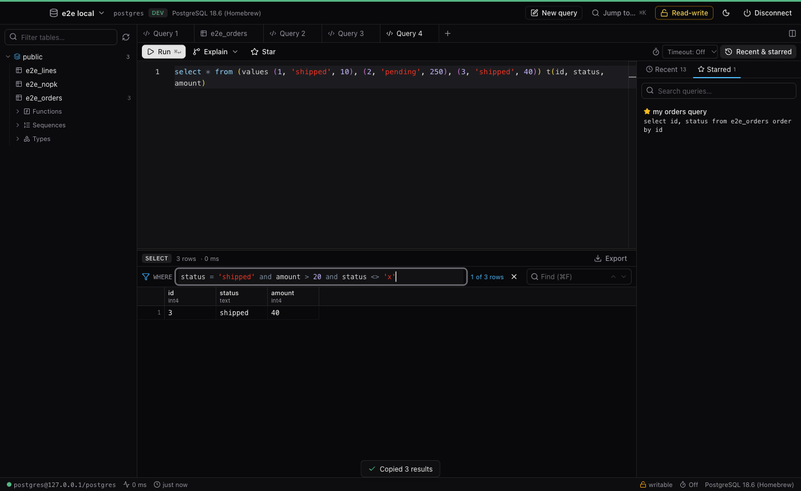
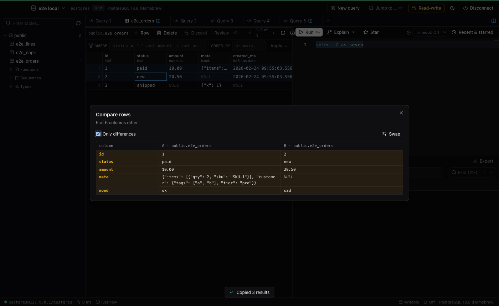
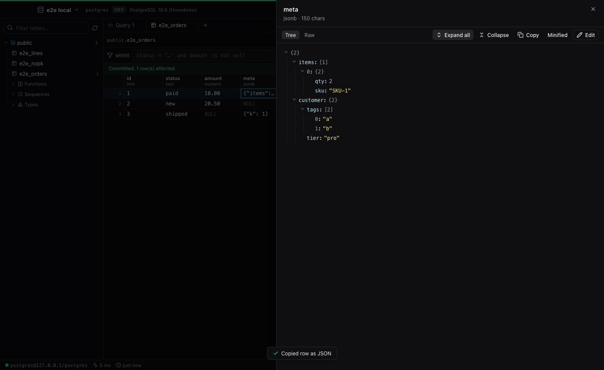

<div align="center">


# ViewDeck: free, open-source database GUI for PostgreSQL and AWS RDS

**A fast, keyboard-first desktop SQL client.** Connect to PostgreSQL, Amazon RDS and
Aurora (even private databases inside a VPC) in seconds, with no bastion host, no SSH
keys and no stored passwords.

**100% free and open source (MIT).** No account, no paid tier, no telemetry.

macOS · PostgreSQL · Amazon RDS · Aurora · AWS SSO · MIT licensed

</div>



## Why ViewDeck?

If your databases live on AWS, getting to them is usually the hardest part of your day:

- **Private RDS means a bastion dance.** You open a terminal, start an SSH tunnel or an
  `aws ssm start-session` port forward, remember which local port you used, and then
  point your SQL client at `localhost`. When the tunnel dies, you start over.
- **IAM database auth tokens expire every 15 minutes.** Most clients treat the token as
  a static password, so you end up pasting a fresh `generate-db-auth-token` output
  again and again.
- **TLS breaks through tunnels.** The certificate is for `*.rds.amazonaws.com`, but
  you're connecting to `127.0.0.1`, so people switch verification off.
- **One wrong query on prod is one too many.** An `UPDATE` without a `WHERE`, or a cell
  edit that writes straight away, against a production database.
- **Good database tools cost money**, and many want an account or phone home.

**ViewDeck handles all of it for you.** Pick an AWS profile, sign in with SSO, choose an
RDS instance from the list, and you're in. The tunnel, the IAM tokens and `verify-full`
TLS are handled for you. Prod is read-only by default, edits are staged and shown as
exact SQL before anything is written, and the whole app is free.

It is also built to grow beyond Postgres: the UI talks to a small `DatabaseDriver`
contract, so new database engines plug in without changes to the app.

## Free and open source

ViewDeck is completely free: MIT licensed, with no paid "pro" features, no license key,
no sign-up and no usage tracking. The only network traffic is to your own databases and
to AWS. Use it at work or at home, fork it, or add your own database driver.

## Supported databases

| Engine | Status |
| --- | --- |
| PostgreSQL (incl. Amazon RDS & Aurora PostgreSQL) | ✅ Supported |
| MySQL / MariaDB (incl. Aurora MySQL) | Planned |
| SQLite | Planned |
| ClickHouse | Planned |
| Others (DynamoDB, …) | Planned. [Adding an engine](docs/ADDING_A_DATABASE.md) is one folder and one registration line |

## Highlights

### Write and run SQL
- **Monaco editor** (the VS Code editor) with schema-aware autocomplete for schemas, tables,
  columns and aliases, all instant from a local schema cache.
- **`⌘↵` runs the statement under the cursor**, or the selection. Errors are underlined
  at the exact position the database reports.
- **Run a whole script at once.** Every statement runs in turn and a failure doesn't
  stop the rest. The **All** tab shows each query with its output, like a terminal, and
  **Copy all** puts every query and its result on the clipboard as Markdown, plain text
  or JSON. Handy for the batch of queries an AI agent hands you.
- **EXPLAIN / EXPLAIN ANALYZE** (`⌘E` / `⌘⇧E`) as a plan tree with timings and misestimate
  warnings. ANALYZE runs inside a transaction that is always rolled back.
- Recent and starred queries, statement timeouts, and cancel for long-running queries.


### Explore results
- **Live filter**: type a SQL `WHERE` condition above any result and the rows narrow as
  you type. It runs on the loaded rows, so nothing is sent to the database. A half-typed
  condition shows every row instead of an error.
- **Find in results** (`⌘F`) highlights matching cells and jumps between them.
- **Virtualised grid** for 100k+ rows, keyboard cell navigation, copy as TSV, CSV, JSON,
  Markdown, SQL `INSERT` or a `WHERE` clause, and export to CSV or JSON.
- **JSON / JSONB viewer** with a collapsible tree. Epoch columns render as dates, and
  timestamps show local, UTC and relative time on hover.
- **Foreign-key navigation**: jump to the referenced row, or list the rows that point
  here.
- **Split view** of two tabs side by side, and **compare rows** with the differences
  highlighted.

<table>
<tr>
<td></td>
<td></td>
</tr>
<tr>
<td></td>
<td></td>
</tr>
</table>

### Edit data safely
- **Staged edits.** Editing a cell never writes. `⌘S` shows the exact parameterised
  SQL in one `BEGIN … COMMIT`, and the commit is all-or-nothing, with expected-row
  checks.
- **Read-only by default outside dev**, enforced by the server (not just hidden
  buttons), with an environment-coloured frame: prod red, staging amber, dev green.
- **Destructive SQL asks first**: `UPDATE`/`DELETE` without `WHERE`, `TRUNCATE`, `DROP`.
  On prod you type the database name to confirm.


### Connect to cloud databases
- **AWS built in.** Pick a profile from `~/.aws`, sign in with AWS SSO inline, and pick
  an RDS instance or Aurora cluster from a discovered list.
- **Private databases without SSH keys.** ViewDeck opens an SSM port-forwarding tunnel
  through an SSM-managed EC2 host automatically, and cleans it up when you disconnect.
- **IAM database auth done right**: a fresh 15-minute token for every new pooled
  connection, and `verify-full` TLS against the real RDS hostname even through a
  `127.0.0.1` tunnel.
- **No plaintext secrets.** Passwords are encrypted with the OS keychain, and AWS
  credentials are never stored by ViewDeck.

### Keyboard-first
`⌘K` command palette (tables, schemas, recent queries, connections, actions) · `⌘T` new
tab · `⌘↵` run · `⌘E` explain · `⌘F` filter / find · `⌘S` review changes · `Ctrl+Tab`
switch tabs · `⌘,` settings. Light, dark or follow-the-system theme.

## Install

There are no prebuilt releases yet, so build it from source (macOS, Apple Silicon or
Intel):

```sh
git clone https://github.com/Adityagaddhyan/viewdeck.git
cd viewdeck
npm install
npm run dist:dir
cp -R release/mac*/ViewDeck.app /Applications/
```

Builds aren't notarised yet, so on first launch right-click **ViewDeck.app → Open**.

**Requirements:** Node ≥ 22.13. For AWS features: AWS CLI v2, plus the Session Manager
plugin for private databases:

```sh
brew install awscli && brew install --cask session-manager-plugin
```

## Develop

```sh
npm install
npm run dev            # app with hot reload
npm run verify         # typecheck + unit tests + docs check
npm run test:e2e       # drive the real app against a local TLS Postgres
npm run dist           # package a .dmg / .zip into release/ (docs/PACKAGING.md)
```

- [`AGENTS.md`](AGENTS.md): repo map, invariants and conventions (for humans and AI
  agents alike).
- [`ARCHITECTURE.md`](ARCHITECTURE.md): process model, IPC, token and tunnel lifecycles.
- [`docs/ADDING_A_DATABASE.md`](docs/ADDING_A_DATABASE.md): how to add an engine.
- [`docs/ROADMAP.md`](docs/ROADMAP.md): what's next.
- [`docs/adr/`](docs/adr/): why the big decisions were made.

Contributions are welcome, especially new database drivers. If ViewDeck saves you time,
a ⭐ on GitHub helps other developers find it.

## FAQ

**Is ViewDeck free?**
Yes, completely: MIT-licensed open source, with no paid tier, no account and no telemetry.

**How do I connect to a private RDS or Aurora PostgreSQL database without a bastion host or SSH keys?**
Choose the **SSM tunnel** route when you add an AWS connection. ViewDeck starts an AWS
Systems Manager port forward through an SSM-managed EC2 instance in the same VPC, keeps
it alive while you work, and closes it when you disconnect. If you're already on a VPN
that reaches the VPC, the **Direct** route connects straight to the endpoint.

**Does it support RDS IAM database authentication?**
Yes. ViewDeck signs a fresh IAM auth token for every new pooled connection, so the
15-minute expiry never interrupts you, and it verifies TLS against the real RDS
hostname, even through a tunnel.

**Does it work with AWS SSO (IAM Identity Center)?**
Yes. It reads your profiles from `~/.aws` and offers an inline "Sign in with AWS SSO"
when a session has expired.

**How is it different from TablePlus, DataGrip, DBeaver or pgAdmin?**
Those are great general-purpose tools. ViewDeck is free and focused: AWS connectivity
(SSO, RDS discovery, IAM tokens, SSM tunnels) is built in rather than bolted on, writes
are safe by default (staged edits, read-only prod, destructive-query checks), and the
whole app is designed for the keyboard.

**Which databases are supported?**
PostgreSQL today, including Amazon RDS and Aurora PostgreSQL. MySQL/MariaDB, SQLite and
ClickHouse are planned; see [adding a database engine](docs/ADDING_A_DATABASE.md).

**Windows or Linux?**
ViewDeck is built and tested on macOS today. It's an Electron app, so Windows and Linux
builds are possible and contributions are welcome.

## Security model

The UI runs in a sandboxed renderer with context isolation and no Node access. Every
privileged action (database connections, AWS calls, child processes, local storage)
lives in the main process behind one typed, validated IPC contract. See
[`ARCHITECTURE.md`](ARCHITECTURE.md).

## License

[MIT](LICENSE)
