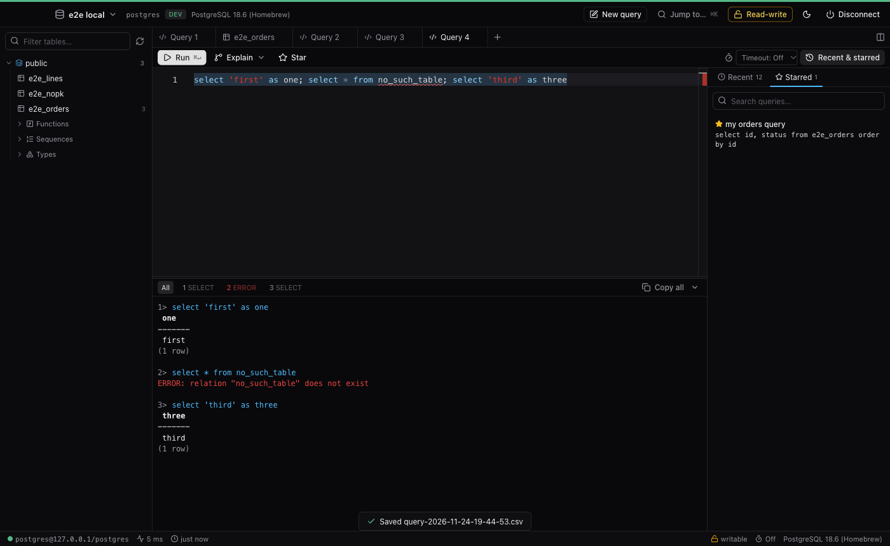
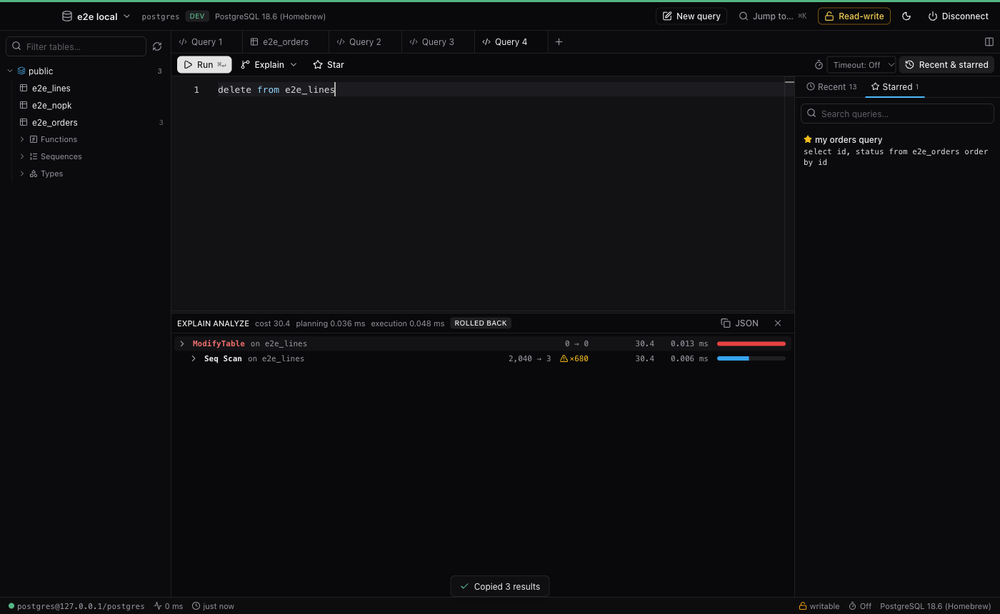
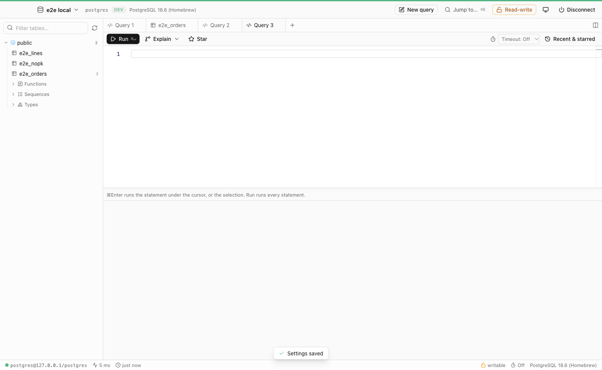
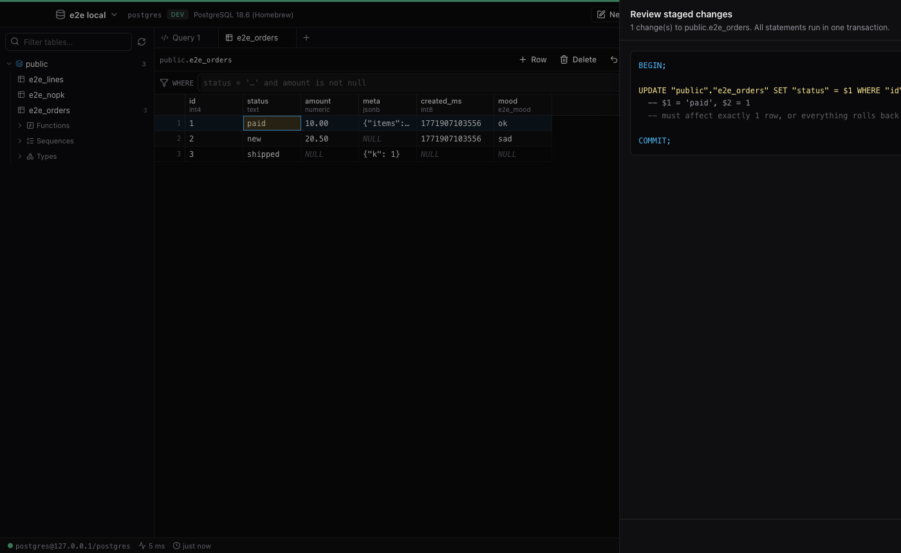

<div align="center">


# ViewDeck

**A fast, keyboard-first desktop client for your databases.**
Query, browse and safely edit data, with first-class support for databases that live in the cloud.

macOS · Electron · MIT licensed

</div>


ViewDeck is a database GUI for developers who live in the keyboard. It pairs a real SQL
editor with a fast virtualised grid, makes writes safe by default, and connects to
cloud-hosted databases (including private ones behind a VPC) without SSH keys or stored
passwords.

It is built engine-agnostic from day one: the UI talks to a small `DatabaseDriver`
contract, so new databases plug in without touching the app. **PostgreSQL is supported
today**, and more engines are on the way.

## Databases

| Engine | Status |
| --- | --- |
| PostgreSQL (incl. Amazon RDS & Aurora PostgreSQL) | ✅ Supported |
| MySQL / MariaDB (incl. Aurora MySQL) | Planned |
| SQLite | Planned |
| ClickHouse | Planned |
| Others (DynamoDB, …) | Planned. [Adding an engine](docs/ADDING_A_DATABASE.md) is one folder and one registration line |

## Highlights

### Write and run SQL
- **Monaco editor** (the VS Code editor) with schema-aware autocomplete for schemas, tables,
  columns and aliases, all instant from a local schema cache.
- **`⌘↵` runs the statement under the cursor**, or the selection. Errors are underlined
  at the exact position the database reports.
- **Run a whole script at once.** Every statement runs in turn and a failure doesn't
  stop the rest. The **All** tab shows each query with its output, like a terminal, and
  **Copy all** puts every query and its result on the clipboard as Markdown, plain text
  or JSON. Handy for the batch of queries an AI agent hands you.
- **EXPLAIN / EXPLAIN ANALYZE** (`⌘E` / `⌘⇧E`) as a plan tree with timings and misestimate
  warnings. ANALYZE runs inside a transaction that is always rolled back.
- Recent and starred queries, statement timeouts, and cancel for long-running queries.



### Explore results
- **Live filter**: type a SQL `WHERE` condition above any result and the rows narrow as
  you type. It runs on the loaded rows, so nothing is sent to the database. A half-typed
  condition shows every row instead of an error.
- **Find in results** (`⌘F`) highlights matching cells and jumps between them.
- **Virtualised grid** for 100k+ rows, keyboard cell navigation, copy as TSV, CSV, JSON,
  Markdown, SQL `INSERT` or a `WHERE` clause, and export to CSV or JSON.
- **JSON / JSONB viewer** with a collapsible tree. Epoch columns render as dates, and
  timestamps show local, UTC and relative time on hover.
- **Foreign-key navigation**: jump to the referenced row, or list the rows that point
  here.
- **Split view** of two tabs side by side, and **compare rows** with the differences
  highlighted.

<table>
<tr>
<td></td>
<td></td>
</tr>
<tr>
<td></td>
<td></td>
</tr>
</table>

### Edit data safely
- **Staged edits.** Editing a cell never writes. `⌘S` shows the exact parameterised
  SQL in one `BEGIN … COMMIT`, and the commit is all-or-nothing, with expected-row
  checks.
- **Read-only by default outside dev**, enforced by the server (not just hidden
  buttons), with an environment-coloured frame: prod red, staging amber, dev green.
- **Destructive SQL asks first**: `UPDATE`/`DELETE` without `WHERE`, `TRUNCATE`, `DROP`.
  On prod you type the database name to confirm.



### Connect to cloud databases
- **AWS built in.** Pick a profile from `~/.aws`, sign in with AWS SSO inline, and pick
  an RDS instance or Aurora cluster from a discovered list.
- **Private databases without SSH keys.** ViewDeck opens an SSM port-forwarding tunnel
  through an SSM-managed EC2 host automatically, and cleans it up when you disconnect.
- **IAM database auth done right**: a fresh 15-minute token for every new pooled
  connection, and `verify-full` TLS against the real RDS hostname even through a
  `127.0.0.1` tunnel.
- **No plaintext secrets.** Passwords are encrypted with the OS keychain, and AWS
  credentials are never stored by ViewDeck.

### Keyboard-first
`⌘K` command palette (tables, schemas, recent queries, connections, actions) · `⌘T` new
tab · `⌘↵` run · `⌘E` explain · `⌘F` filter / find · `⌘S` review changes · `Ctrl+Tab`
switch tabs · `⌘,` settings. Light, dark or follow-the-system theme.

## Install

There are no prebuilt releases yet, so build it from source (macOS, Apple Silicon or
Intel):

```sh
git clone https://github.com/Adityagaddhyan/viewdeck.git
cd viewdeck
npm install
npm run dist:dir
cp -R release/mac*/ViewDeck.app /Applications/
```

Builds aren't notarised yet, so on first launch right-click **ViewDeck.app → Open**.

**Requirements:** Node ≥ 22.13. For AWS features: AWS CLI v2, plus the Session Manager
plugin for private databases:

```sh
brew install awscli && brew install --cask session-manager-plugin
```

## Develop

```sh
npm install
npm run dev            # app with hot reload
npm run verify         # typecheck + unit tests + docs check
npm run test:e2e       # drive the real app against a local TLS Postgres
npm run dist           # package a .dmg / .zip into release/ (docs/PACKAGING.md)
```

- [`AGENTS.md`](AGENTS.md): repo map, invariants and conventions (for humans and AI
  agents alike).
- [`ARCHITECTURE.md`](ARCHITECTURE.md): process model, IPC, token and tunnel lifecycles.
- [`docs/ADDING_A_DATABASE.md`](docs/ADDING_A_DATABASE.md): how to add an engine.
- [`docs/ROADMAP.md`](docs/ROADMAP.md): what's next.
- [`docs/adr/`](docs/adr/): why the big decisions were made.

Contributions are welcome, especially new database drivers.

## Security model

The UI runs in a sandboxed renderer with context isolation and no Node access. Every
privileged action (database connections, AWS calls, child processes, local storage)
lives in the main process behind one typed, validated IPC contract. See
[`ARCHITECTURE.md`](ARCHITECTURE.md).

## License

[MIT](LICENSE)
